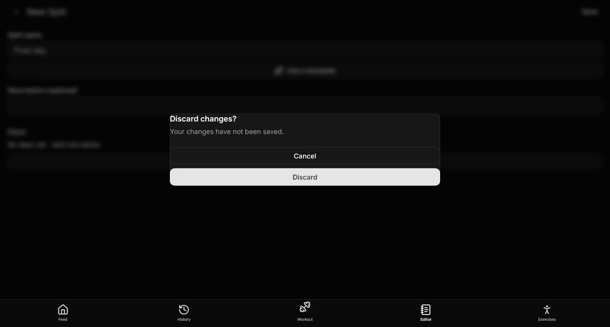
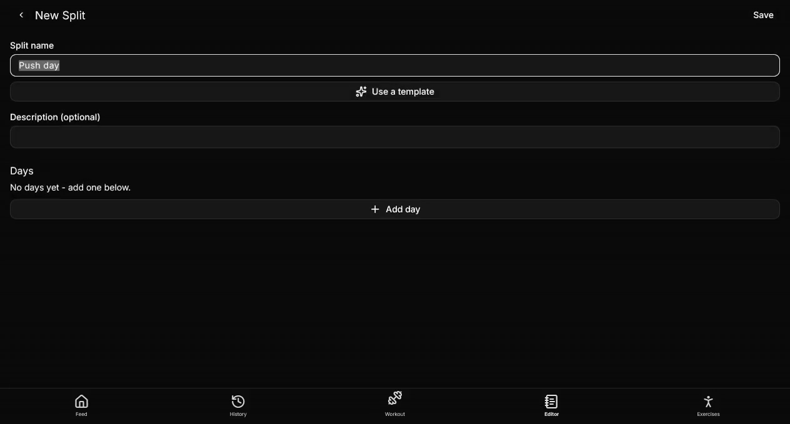
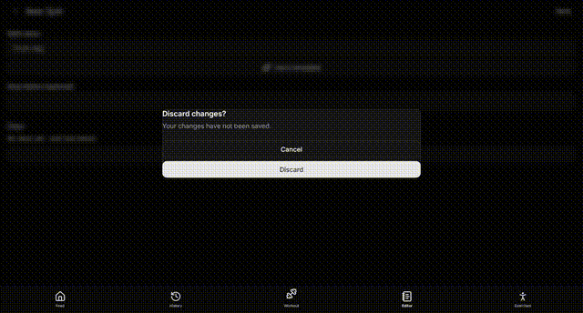

## Problem

In `tracker/lib/routing/home_page.dart`, the root `PopScope`'s `onPopInvokedWithResult` awaits `_handlePop()` (the active tab navigator's `maybePop`, which is what shows the split editor's "Discard changes?" dialog). While that dialog was still open, a second system-back press fell through the unguarded path and could reach `SystemNavigator.pop()`, killing the whole app. On the current Flutter (3.47.7) the observable wrong behavior on the real window was the second back dismissing the pending dialog behind the user's back, via that same unguarded exit path.

## Fix (dialog-aware exit guard, local to home_page.dart)

- Each tab navigator gets a small `NavigatorObserver` (`_TabModalTracker`) that counts the modal routes (`PopupRoute` subclasses: `FDialogRoute`, `showDialog`, bottom sheets) currently on that tab's stack.
- While the active tab has a modal on its stack, or a previous back press is still being handed to `maybePop` (`_interceptInFlight`), `_handlePop()` swallows the press instead of letting it pop the pending dialog or fall through to `SystemNavigator.pop()`.
- Plain page routes are deliberately not counted: subpages stay poppable by back. Answering the dialog (Cancel/Discard) restores normal behavior; back at the tab root still exits the app (existing test unchanged and green).

## Verification

- New widget test `tracker/test/ui/navigation_dialog_back_test.dart`:
  - second system back while the discard dialog is up is swallowed, no `SystemNavigator.pop` call, dialog and editor stay up (fails on `main`, passes here);
  - after the dialog is answered, back at the tab root still exits.
- Existing navigation tests (`navigation_stale_back_test.dart`) unchanged and green; full `flutter test` suite green (118 tests); `flutter analyze` clean.
- Regression proof: with the fix stashed, the new swallow test fails (dialog dismissed by second back); with the fix, it passes.

## Before / After

Recorded on the real Windows window (`flutter test -d windows` driving `tracker/integration_test/capture_back_guard_test.dart`, recorded with ffmpeg gdigrab per `docs/CAPTURING_MEDIA.md`). Scenario in both: Editor tab -> New Split -> type a title (dirty) -> system back #1 (discard dialog appears) -> system back #2 while the dialog is up.

**Before (without the fix):** the second back dismisses the pending dialog behind the user's back - the unguarded exit path that can reach `SystemNavigator.pop()` and kill the app.

**After (with the fix):** the second back is swallowed; the dialog stays up and the app survives; answering the dialog then backing at the tab root still exits normally.

GIF previews (frame-accurate to the videos):

## Notes

- The desktop window used for the captures runs with throwaway data (in-memory storage + temp Isar), never real app data.
- Full recordings: [before-second-back.mp4](before-second-back.mp4), [after-second-back.mp4](after-second-back.mp4).
